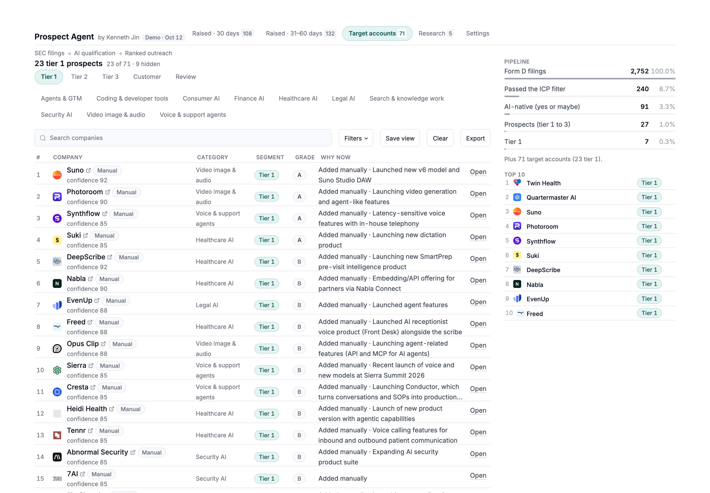
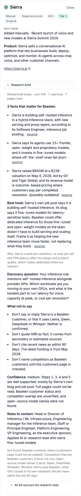

# Prospect Agent

Prospect Agent finds AI startups that just raised money, sorts them into sales segments using a written ideal customer profile (ICP), and drafts outreach citing only facts it can point to. It finds prospects for Baseten, an AI inference platform.

Live demo: [link coming soon]



## Results from the last run

60 days of SEC filings (August 14 to October 12, 2026):

| Step | Companies |
|---|---|
| Form D filings found (investment funds removed) | 2,752 |
| After the ICP filter (tech or health care, US, $10M+ raise, one row per company) | 240 |
| AI-native, judged from each company's website | 45 yes, 46 maybe |
| Tier 1: AI-native scale-ups | 7 |
| Tier 2: enterprise and regulated | 7 |
| Tier 3: early-stage, nurture | 14 |
| Existing Baseten customers (no outreach) | 3 |
| Needs a human review / deprioritized | 13 / 50 |

74 target accounts were also imported by hand (23 of them tier 1), and 5 companies got a full research brief. Everything, including the imports and research, cost about $12 in API calls.

## How it works

1. **Find** (`edgar.py`). Form D is the notice startups file with the SEC when they raise money. The tool reads each filing's company, round size, and executives.
2. **Filter** (`edgar.py`). Keeps US tech and health care companies raising $10M or more. Filtering is free, so it runs before any paid step.
3. **Qualify** (`qualify.py`). Claude Haiku reads the company's website and returns a verdict with an exact quote as evidence.
4. **Segment** (`fit.py`). Claude Sonnet collects quoted evidence; code applies fixed rules to decide the segment and an A/B/C fit grade.
5. **Draft** (`agent.py`). Claude writes a brief and fills in the company-specific parts of an email template.

## The three-tier ICP

The ICP lives in `icp.md`, a plain document anyone can edit.

- **Tier 1, AI-native scale-ups** (Series B and later): a full five-email sequence.
- **Tier 2, enterprise and regulated:** the same sequence, leading with security and data control.
- **Tier 3, early-stage:** one short email, plus a note on when to reach out again.
- **Existing customers:** routed to account management, no cold email.
- **Needs review and deprioritized:** no email.

Stage comes from the Form D round size ($24.5M and up suggests Series B). If the filing doesn't say, the company goes to human review.

## Working the list

The app has three ranked lists: raised in the last 30 days, raised 31 to 60 days ago, and target accounts added by hand or CSV import. A Top 10 pulls the best from all three.

Opening a company shows why now, which roles to contact (roles, never names), the emails, one-click research links, and the evidence behind its segment. In live mode, a research brief runs Claude Sonnet with web search and web fetch (about 30 cents), and every source link is checked against the pages the tools actually returned.



## Design decisions

- **Evidence quotes are verified by code.** Every quote must appear word for word on the company's website, or it is dropped.
- **Code makes the decisions, not the model.** The same evidence always gives the same segment, and each row records the rule that decided it.
- **Facts only, assumptions labeled.** Claims about Baseten come from a short fact sheet. Anything inferred is listed as an assumption.
- **Nothing is paid for twice.** Filings, verdicts, evidence, and website text are saved, so changing a rule re-scores companies for free.
- **The demo hides personal names.** Contacts are shown as roles only.

## Run it yourself

```bash
git clone https://github.com/kennethjinclaude/prospect-agent.git
cd prospect-agent
python3.14 -m venv .venv
source .venv/bin/activate
pip install -r requirements.txt
```

Create a `.env` file (the SEC asks every visitor for a contact email):

```
ANTHROPIC_API_KEY=your-key
SEC_USER_EMAIL=you@example.com
```

Then run `streamlit run app.py`. Demo mode works right away. To run new searches, add `APP_PASSWORD = "..."` to `.streamlit/secrets.toml`; the app shows a cost estimate before every paid step.

## Limitations

- **Form D misses companies.** Startups that raise without filing never show up, and large enterprises rarely file at all.
- **Websites rarely say which models a company runs,** so few companies earn an A grade.
- **Next:** read job posts and engineering blogs for ML infrastructure hiring, the strongest trigger in the ICP.

## Built by Kenneth Jin

Built with Claude Code as an AI pair programmer. Independent portfolio project, not affiliated with Baseten; no emails were sent.
